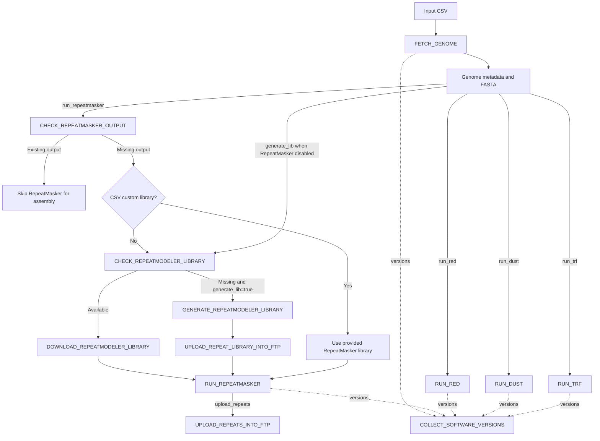

# Repeat Pipeline

The **Ensembl Repeat Pipeline** is a Nextflow DSL2 workflow for repeat annotation of genome assemblies. It supports reuse or de novo generation of RepeatModeler libraries, RepeatMasker annotation, and independent analyses using RED, DUST and Tandem Repeat Finder (TRF). Generated RepeatModeler libraries and RepeatMasker outputs can be published to configured Ensembl FTP locations.

## Quick Links

- [Input Specification](input.md)
- [Output Reference](output.md)
- [Parameter Reference](parameters.md)
- [Workflow Documentation](workflows/index.md)
- [Module Documentation](modules/index.md)
- [Troubleshooting](troubleshooting.md)

## Overview

The workflow reads a CSV samplesheet, obtains genome assemblies using `FETCH_GENOME`, and executes enabled analysis branches. When RepeatMasker is enabled, it first checks whether the expected masked genome already exists at the configured remote location. Assemblies with an existing output are **skipped** for RepeatMasker library selection and execution; missing outputs continue to library selection. RED, DUST and TRF operate independently on fetched genomes when enabled.

The workflow uses the `nf-schema` plugin for parameter validation and summary logging. Software-version outputs from executed modules are collected by `COLLECT_SOFTWARE_VERSIONS`.

## Workflow



**Diagram notes:** The check for existing RepeatMasker output is performed only when `run_repeatmasker=true`. An existing RepeatModeler library is downloaded for RepeatMasker use; a missing one is generated only when `generate_lib=true`. The library-generation path may also run independently when RepeatMasker is disabled and `generate_lib=true`. Dotted version edges are representative: other executed modules also contribute versions.

## Input

Pass a CSV file with a header row via `--csvFile`. The main workflow reads these columns:

| Column | Purpose |
|---|---|
| `gca` | Assembly accession used in remote paths and library identification. |
| `species_name` | Species identifier used in FTP paths. |
| `genome_file` | Optional genome file value passed to `FETCH_GENOME`. |
| `repeatmasker_library` | Optional custom library path; when supplied, this bypasses RepeatModeler library selection for that assembly. |

Example CSV (illustrative; replace with actual assemblies and paths):

```csv
gca,species_name,genome_file,repeatmasker_library
GCA_EXAMPLE_001,example_species,,
```

The workflow reads these four fields; additional validation constraints may be imposed by `assets/schema_input.json` and the `FETCH_GENOME` module. See [Input Specification](input.md).

## Running the pipeline

From the appropriate pipeline directory, with Nextflow and the configured execution environment available:

```bash
nextflow run main.nf \
  --csvFile samples.csv \
  --outdir results \
  --run_repeatmasker true \
  --generate_lib true \
  --run_red true \
  --run_dust true \
  --run_trf true \
  --upload_repeats true
```

For a run using the `standard` profile defined in the repeat configuration, add `-profile standard` when that configuration is loaded. This profile uses SLURM. Confirm the correct configuration entry point for your repository, because the repeat config includes `../../nextflow.config`.

**Important:** `run_repeatmasker`, `generate_lib`, `run_red`, `run_dust`, and `run_trf` default to `false` in the supplied repeat config. Explicitly enable the analyses you want. `upload_repeats` defaults to `true`, but it only receives RepeatMasker outputs that are produced by the workflow.

### Example modes

RepeatMasker with library reuse or generation:

```bash
nextflow run main.nf --csvFile samples.csv --outdir results --run_repeatmasker true --generate_lib true
```

RepeatModeler library generation without RepeatMasker:

```bash
nextflow run main.nf --csvFile samples.csv --outdir results --generate_lib true
```

RED only:

```bash
nextflow run main.nf --csvFile samples.csv --outdir results --run_red true --upload_repeats false
```

DUST or TRF can be enabled independently with `--run_dust true` or `--run_trf true`.

## RepeatMasker and RepeatModeler behavior

1. `CHECK_REPEATMASKER_OUTPUT` checks the configured URL for an existing masked genome.
2. An assembly whose status file contains `true` enters the **available** branch and is excluded from downstream RepeatMasker library selection.
3. For missing outputs, the workflow uses a CSV-provided `repeatmasker_library` when present.
4. Otherwise, `CHECK_REPEATMODELER_LIBRARY` checks for a remote RepeatModeler library.
5. If available, the library is downloaded. If missing and `generate_lib=true`, the library is generated and uploaded.
6. The resulting library is passed to `RUN_REPEATMASKER`. When `upload_repeats=true`, newly generated RepeatMasker outputs are passed to the FTP upload module.

If a RepeatModeler library is missing and `generate_lib=false`, the workflow raises an error for that assembly rather than silently generating a library.

**Remote-path verification:** The current `main.nf` constructs the RepeatMasker check URL using `${params.repeatmasker_ftp_base}/${meta.species_name}/${meta.gca}_genome.masked.fa`. A source comment explicitly says to verify this filename against the actual FTP output. The RepeatModeler URL uses `${meta.gca}.repeatmodeler.fa` under the species directory.

## Independent analyses

| Option | Module | Behavior |
|---|---|---|
| `--run_red true` | `RUN_RED` | Runs RED on the fetched genome. |
| `--run_dust true` | `RUN_DUST` | Runs DUST on the fetched genome. |
| `--run_trf true` | `RUN_TRF` | Runs Tandem Repeat Finder on the fetched genome. |

These branches do **not** depend on RepeatMasker succeeding or running. In the provided `main.nf`, their output-channel additions to `ch_repeat_output` are commented out; therefore the final `UPLOAD_REPEATS_INTO_FTP` call receives RepeatMasker outputs, not RED/DUST/TRF outputs, unless the workflow is changed.

## Key parameters

| Parameter | Supplied config default | Description |
|---|---|---|
| `csvFile` | `null` | Input samplesheet. |
| `outdir` | Inherited / schema `./results` | Output directory; confirm parent config. |
| `generate_lib` | `false` | Generate a missing RepeatModeler library. |
| `run_repeatmasker` | `false` | Enable RepeatMasker, with existing-output check. |
| `run_red` | `false` | Enable RED. |
| `run_dust` | `false` | Enable DUST. |
| `run_trf` | `false` | Enable TRF. |
| `upload_repeats` | `true` | Upload newly produced RepeatMasker outputs. |
| `repeatmodeler_ftp_base` | Configured Ensembl URL | Remote RepeatModeler library location. |
| `repeatmasker_ftp_base` | Configured Ensembl URL | Remote RepeatMasker output location. |
| `repeatmodeler_ftp_local` | Configured NFS directory | Destination for generated RepeatModeler libraries. |
| `repeatmasker_ftp_local` | Configured NFS directory | Destination for RepeatMasker outputs. |
| `cacheDir` | `${params.outdir}/cache` | Cache directory. |
| `cleanCache` | `false` | Cache cleanup option; implementation must be verified. |

Other configurable paths, engines, TRF scoring parameters and resource settings are documented in [Parameter Reference](parameters.md). The schema and repeat config supplied earlier differ in the defaults for `ncbiBaseUrl` and `repeatmasker_ftp_base`; align them before publication.

## Outputs and publication

Depending on enabled branches, the pipeline may produce downloaded genome assemblies, downloaded or newly generated RepeatModeler libraries, RepeatMasker masked-genome outputs, and results from RED, DUST and TRF. The workflow also collects module software-version information.

- Newly generated RepeatModeler libraries are passed to `UPLOAD_REPEAT_LIBRARY_INTO_FTP` using `repeatmodeler_ftp_local`.
- New RepeatMasker outputs are passed to `UPLOAD_REPEATS_INTO_FTP` when `upload_repeats=true`.
- Existing RepeatMasker annotations detected remotely are skipped, not re-uploaded through `ch_repeat_output`.
- RED, DUST and TRF are executed independently, but their upload outputs are not wired into `ch_repeat_output` in the current workflow.

Exact output filenames, formats and published directories depend on the individual module implementations; see [Output Reference](output.md) and [Module Documentation](modules/index.md).

## Modules

| Process name in `main.nf` | Source module |
|---|---|
| `FETCH_GENOME` | `modules/fetch_genome.nf` |
| `CHECK_REPEATMODELER_LIBRARY`, `CHECK_REPEATMASKER_OUTPUT` | `modules/check_ftp.nf` (aliased) |
| `GENERATE_REPEATMODELER_LIBRARY` | `modules/generate_repeatmodeler_library.nf` |
| `DOWNLOAD_REPEATMODELER_LIBRARY` | `modules/download_repeatmodeler_library.nf` |
| `RUN_REPEATMASKER` | `modules/run_repeatmasker.nf` |
| `RUN_RED` | `modules/run_red.nf` |
| `RUN_DUST` | `modules/run_dust.nf` |
| `RUN_TRF` | `modules/run_trf.nf` |
| `UPLOAD_REPEAT_LIBRARY_INTO_FTP`, `UPLOAD_REPEATS_INTO_FTP` | `modules/upload_into_ftp.nf` (aliased) |
| `COLLECT_SOFTWARE_VERSIONS` | `modules/collect_software_versions.nf` |

See [Module Documentation](modules/index.md) and [Workflow Documentation](workflows/index.md).

## Execution environment

The supplied repeat configuration enables Singularity, defines a `standard` SLURM profile, sets retry handling for selected exit codes, and specifies resource requirements and containers by process label. Some executable paths and FTP destinations point to Ensembl-specific `/hps/` and `/nfs/` locations; adjust or make these available in other environments.

## Validation and troubleshooting

The entry workflow calls `validateParameters()` and logs `paramsSummaryLog(workflow)`. The RepeatMasker and RepeatModeler availability checks interpret status-file content as `true` or `false`.

If an assembly unexpectedly runs RepeatMasker despite existing annotations, verify the constructed RepeatMasker URL, the `CHECK_REPEATMASKER_OUTPUT` status file and that library selection consumes `repeatmaskerData` (the missing branch), not all of `genomeData`.

The uploaded workflow logs `meta.taxon_id` in RepeatMasker status messages, although the CSV mapping defines `gca` rather than `taxon_id`. For useful logs, change these messages to `meta.gca`.

See [Troubleshooting](troubleshooting.md).

## Reproducibility

Executed modules contribute version information to `ch_versions_file`, which is collected and passed to `COLLECT_SOFTWARE_VERSIONS`. The precise filename and output location are determined by that module.

## License

Apache License, Version 2.0, as declared in the pipeline source header.
