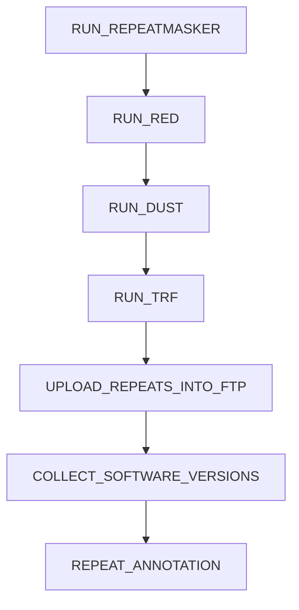

<!--
AUTO-GENERATED FILE.

Generated by docs/generate_docs.py

Do not edit manually.
-->

# Main

See the NOTICE file distributed with this work for additional information
regarding copyright ownership.
Licensed under the Apache License, Version 2.0 (the "License");
you may not use this file except in compliance with the License.
You may obtain a copy of the License at
http://www.apache.org/licenses/LICENSE-2.0
Unless required by applicable law or agreed to in writing, software
distributed under the License is distributed on an "AS IS" BASIS,
WITHOUT WARRANTIES OR CONDITIONS OF ANY KIND, either express or implied.
See the License for the specific language governing permissions and
limitations under the License.
ENSEMBL REPEAT ANNOTATION PIPELINE
This Nextflow DSL2 workflow performs repeat annotation of genome assemblies
using RepeatModeler, RepeatMasker, RED, DustMasker, and Tandem Repeat Finder
(TRF).
The pipeline supports reuse of existing repeat annotations and repeat
libraries, de novo RepeatModeler library generation, and optional publication
of generated results to the Ensembl FTP infrastructure.
Pipeline Stages:
1. FETCH_GENOME
Retrieve or locate genome assemblies specified in the input CSV.
2. CHECK_REPEATMASKER_OUTPUT
Check whether RepeatMasker annotations already exist on Ensembl FTP.
Assemblies with existing annotations skip RepeatMasker processing.
3. REPEAT LIBRARY SELECTION
For assemblies requiring RepeatMasker annotation:
- Use a custom library when supplied in the input CSV.
- Otherwise, check for an existing RepeatModeler library.
4. CHECK_REPEATMODELER_LIBRARY
Check whether a precomputed RepeatModeler library is available.
5a. DOWNLOAD_REPEATMODELER_LIBRARY
Download an existing RepeatModeler library when available
and RepeatMasker processing is enabled.
5b. GENERATE_REPEATMODELER_LIBRARY
Generate a de novo RepeatModeler library when no existing
library is available and generate_lib is enabled.
6. UPLOAD_REPEAT_LIBRARY_INTO_FTP
Upload newly generated RepeatModeler libraries to Ensembl FTP.
7. RUN_REPEATMASKER
Identify and mask repetitive sequences using the selected library.
Runs only for assemblies missing existing RepeatMasker annotations.
8. RUN_RED
Independently identify repetitive regions using RED.
9. RUN_DUST
Independently identify low-complexity regions using DustMasker.
10. RUN_TRF
Independently identify tandem repeats using TRF.
11. UPLOAD_REPEATS_INTO_FTP
Optionally upload newly generated RepeatMasker outputs
to the configured Ensembl FTP destination.
12. COLLECT_SOFTWARE_VERSIONS
Collect and consolidate software version information
from the executed modules.
Input:
CSV metadata file containing:
- gca
- species_name
- genome_file
- repeatmasker_library
The genome_file and repeatmasker_library fields provide
assembly and custom-library information where applicable.
Output:
Depending on the enabled analyses:
- Retrieved genome assemblies
- Downloaded or newly generated RepeatModeler libraries
- RepeatMasker soft-masked genome outputs
- RED repeat detection results
- DustMasker low-complexity results
- TRF tandem repeat results
- Uploaded RepeatModeler libraries
- Uploaded RepeatMasker annotations
- Consolidated software version information
Execution Parameters:
--csvFile          Input CSV metadata file
--outdir           Pipeline output directory
--generate_lib     Generate missing RepeatModeler libraries
--run_repeatmasker Enable RepeatMasker analysis
--run_red          Enable RED analysis
--run_dust         Enable DustMasker analysis
--run_trf          Enable TRF analysis
--upload_repeats   Upload generated RepeatMasker outputs
Workflow Notes:
- Existing RepeatMasker annotations are checked before library selection.
- Existing RepeatModeler libraries are reused when available.
- Missing RepeatModeler libraries require generate_lib=true.
- Custom RepeatMasker libraries bypass RepeatModeler library selection.
- RED, DUST, and TRF operate independently on fetched genomes.
- Only RepeatMasker outputs are currently connected to the repeat
annotation upload channel.
- Software versions are collected from executed processes.
MAIN WORKFLOW
ENTRY WORKFLOW

## Overview

This workflow invokes **7** modules.

## Modules

| Order | Module |
|------:|--------|
| 1 | `RUN_REPEATMASKER` |
| 2 | `RUN_RED` |
| 3 | `RUN_DUST` |
| 4 | `RUN_TRF` |
| 5 | `UPLOAD_REPEATS_INTO_FTP` |
| 6 | `COLLECT_SOFTWARE_VERSIONS` |
| 7 | `REPEAT_ANNOTATION` |

## Workflow Diagram

## Source

`/Users/ftricomi/Documents/ensembl-genes-nf/pipelines/repeat/main.nf`
